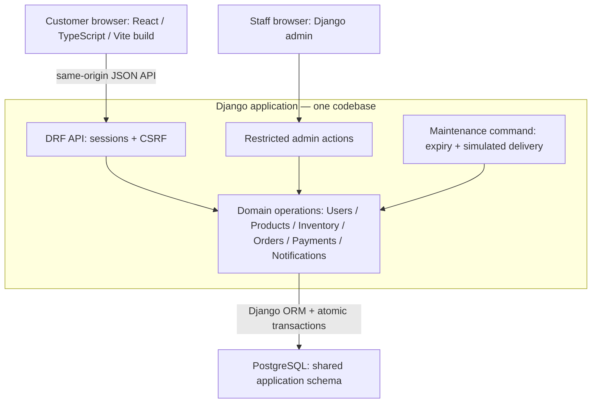

# Architecture Overview

Status: Accepted initial design; no runtime exists.

Single-seller physical-goods EUR store, Django modular monolith, monorepo and six logical domains. React serves customers; Django admin serves permitted staff. One logical PostgreSQL database per environment with a shared application schema.

This is a logical view, not a final deployment topology. Maintenance is a separate local process using the same codebase/domain operations, not a separately owned microservice. Same-origin proxy design does not select a cloud or reverse-proxy vendor. No broker/cache is required initially.

## Boundaries

| Module | Owns |
|---|---|
| Users | Identity/profile and account operations |
| Products | Catalog, category and current price |
| Inventory | Counters, reservations and adjustments |
| Orders | Purchase snapshots, lifecycle and coordination |
| Payments | Simulated payment outcome |
| Notifications | Durable intent and simulated delivery state |

Each module controls its writes. Orders coordinates via in-process operations; exact accepted FKs/lock order are in the [data model](data-model.md). Shared storage is not permission isolation.

## Key Invariants

No overselling, no duplicated transition effects, immutable purchase snapshots, owner-only order access and no post-commit purchase reversal on notification delivery failure. These are testable requirements, not runtime guarantees.

See [purchase workflow](../product/purchase-workflow.md), [application structure](application-structure.md), [data architecture](data-architecture.md), [security](../security/overview.md) and [API](../api/standards.md).

Real payment/shipping/tax rules, public account protections, hosting, availability, recovery and advanced observability remain launch gates in the [decision register](../roadmap/decision-register.md).
