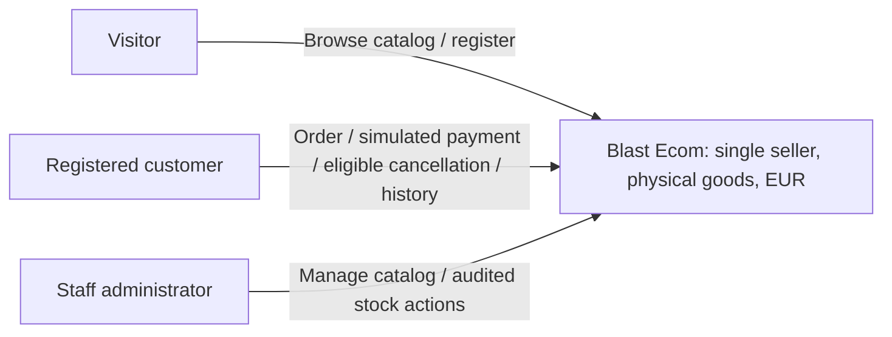

# System Context

Status: Planned C4 Level 1 context; no deployed system exists.

No external identity, payment, logistics or mail provider is selected for the initial local simulation. Payment and notifications are internal simulations. A local development reset mail sink is tooling, not a production provider.

Internal components appear in [architecture overview](overview.md). Public integration, shipping/tax and operational requirements remain gated separately.
