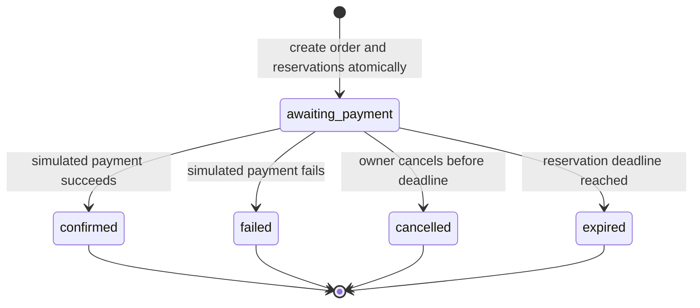

# Purchase Workflow

Status: Accepted design under delegated authority; order/reservation/payment domain operations, customer-facing HTTP endpoints, session/CSRF security, browser journey, local maintenance, and PostgreSQL transaction tests are implemented. Notification processing is simulated; external delivery remains out of scope. Authority: [ADR-0013](../decisions/ADR-0013-initial-product-behavior.md), [ADR-0014](../decisions/ADR-0014-order-reservation-lifecycle.md).

## Product Baseline

Public users browse active products/categories. Checkout requires an active registered account. One logical stock pool tracks whole units; no warehouse routing, backorders or partial fulfillment. A product has a unique SKU, title, description, category, positive two-decimal EUR price and active flag. SKU is immutable after first purchase. Product images initially reference bundled static assets; no remote image fetching or upload capability.

The browser cart is temporary and holds only product IDs/quantities. An order accepts 1–50 distinct products and quantities 1–99 per line. These are configurable abuse/UX bounds, not capacity estimates. Reject duplicate product lines rather than silently merging. Backend prices and stock are authoritative.

## Simulation Boundary

Collect recipient, street address, optional address line 2, city, optional region/postal code and ISO country code in the order snapshot. Do not infer shipping coverage from country selection. Local tests and examples use fictional data.

Shipping is explicitly simulated at EUR 0.00. Product prices are final displayed demo prices; no tax rate, tax breakdown, tax invoice or jurisdiction is asserted. Label checkout as simulated. Before real sales, destination markets, taxes, shipping charges and fulfillment must be agreed. These gaps do not block the local simulated slice.

## State Machine

Confirmed means payment simulation and stock consumption succeeded. It never means shipped or delivered.

## Creation

1. Domain services validate checkout values and scope the operation by user and idempotency key. HTTP authentication/authorization and key-header validation are implemented.
2. Obtain the idempotency record/lock, then lock product rows and stock rows in sorted UUID order.
3. Verify active products, expected unit prices sent by the client and available quantity. A price difference returns 409 PRICE_CHANGED and no order/reservation; the client refreshes and asks for renewed confirmation. Client prices are comparisons, never authority.
4. Snapshot prices, SKU/title and address; calculate line and order totals exactly. Create awaiting_payment order, active reservations and increment reserved counters together.
5. Set expires_at from PostgreSQL wall-clock time plus configured 15 minutes and commit. The domain operation and HTTP endpoint return 201 with a bounded order snapshot.

Insufficient stock, invalid quantities or price conflict produces no partial order/reservation. A created order may later expire or be cancelled, so creation alone does not simulate payment.

## Payment Simulation

The owner-scoped domain operation resolves the explicit payment command. Under order/stock locks, it checks the deadline and terminal status first. Only awaiting_payment may create one payment attempt. Its result is selected by a server-side deterministic simulator (default success; failure injectable only by tests/trusted local configuration). Clients cannot send a payment result or card data. The HTTP endpoint and browser flow are implemented.

- Success: Payments records succeeded, Inventory consumes reservations (decrement on_hand and reserved), Orders sets confirmed.
- Failure: Payments records failed, Inventory releases reserved units, Orders sets failed.
- Database/implementation error: transaction rolls back; order remains payable until its deadline; no half-recorded payment.
- A repeated payment with a new key on confirmed/failed returns the existing attempt without repeating stock effects. On cancelled/expired it returns 409; no new attempt.
- Retry after business failure means create a new order, not retry the failed order.

## Cancellation and Expiry

Only the owner or an explicitly authorized staff command can cancel awaiting_payment before expires_at. Cancelled repeat returns current state with no additional release; confirmed/failed/expired cancellation is 409. When the deadline has already passed, the command atomically expires/releases the order and then returns 409 ORDER_EXPIRED.

The domain exposes bounded expiry processing with one transaction per candidate order and rechecks locked state. The local periodic maintenance command is implemented. Delayed maintenance conservatively withholds availability until release; it never permits payment after expiry. Default reservation duration and cadence are provisional configuration, revisited after UX measurement.

## Notification and Failure

The same transaction creates a uniquely keyed notification intent and sanitized audit entry on terminal state transition. If either required insert fails, the transaction rolls back. Simulated delivery runs later through the maintenance command; failure/restart leaves the intent pending and never reverses the committed order. No actual mail service is called here. The simulator locks the intent and atomically marks it simulated, so concurrent maintenance cannot count delivery twice.

## Critical Scenarios

| Scenario | Required result |
|---|---|
| Two buyers compete for the last unit | At most one active reservation succeeds |
| Client repeats checkout after response loss | Same key returns original response; one order |
| Cancel races with payment | One locked transition wins; no double release/consumption |
| Payment waits past deadline for a lock | Expire rather than confirm; time checked after lock |
| Sweep restarts mid-operation | Committed rows skipped; rolled-back rows retried |
| Product price changes before checkout | 409 and no order; customer reconfirms |
| Product edited after order creation | Order snapshot and payment amount unchanged |
| Notification delivery fails | Purchase remains committed; retry delivery later |
